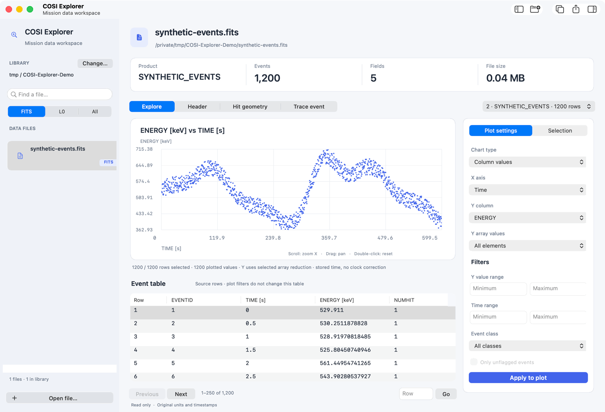

<div align="center">


[](#get-started)
[](https://github.com/mwy-wing/COSI-FITS-EXPLORER/actions/workflows/build.yml)
[](https://github.com/mwy-wing/COSI-FITS-EXPLORER/releases/tag/v0.1.0)
[](LICENSE)

**[Download for Mac ↓](https://github.com/mwy-wing/COSI-FITS-EXPLORER/releases/download/v0.1.0/COSI-Explorer-v0.1.0-macos-arm64.dmg)** · [Try demo data](https://github.com/mwy-wing/COSI-FITS-EXPLORER/releases/download/v0.1.0/synthetic-events.fits) · [User guide](docs/USER_GUIDE.md) · [Contribute](CONTRIBUTING.md)

</div>

A native macOS app for browsing FITS files, visualizing columns, and exploring COSI events.



<p align="center"><sub>Time → Row number → Histogram · Synthetic demo data</sub></p>

## What you can do

- **Inspect** FITS tables, headers, images, and supported COSI packet files.
- **Plot** column values against time or row number, with filters and histograms.
- **Compare** spectra and export your plots to CSV.
- **Explore** hit geometry and trace events across processing stages.

Your files stay on your computer and are opened read-only.

## Get started

**Apple Silicon · macOS 15+**

1. [Download the DMG](https://github.com/mwy-wing/COSI-FITS-EXPLORER/releases/download/v0.1.0/COSI-Explorer-v0.1.0-macos-arm64.dmg), open it, and drag **COSI Explorer** to **Applications**.
2. Open the app, then choose **Open file…** with your own file or the [synthetic demo](https://github.com/mwy-wing/COSI-FITS-EXPLORER/releases/download/v0.1.0/synthetic-events.fits).
3. Choose **X axis → Time / Row number** and pick a **Y column**.

This initial download is **not Apple-notarized**; macOS may block it. See [Apple's guidance](https://support.apple.com/en-us/102445) or build from source below.

<details>
<summary>Build from source</summary>

Install [Xcode Command Line Tools](https://developer.apple.com/xcode/resources/) first, then:

```sh
git clone https://github.com/mwy-wing/COSI-FITS-EXPLORER.git
cd COSI-FITS-EXPLORER
brew install cmake pkg-config cfitsio
bash build.sh
open "dist/COSI Explorer.app"
```

</details>

---

[User guide](docs/USER_GUIDE.md) · [Release guide](docs/RELEASING.md) · [Contributors](AUTHORS.md) · [MIT license](LICENSE)
