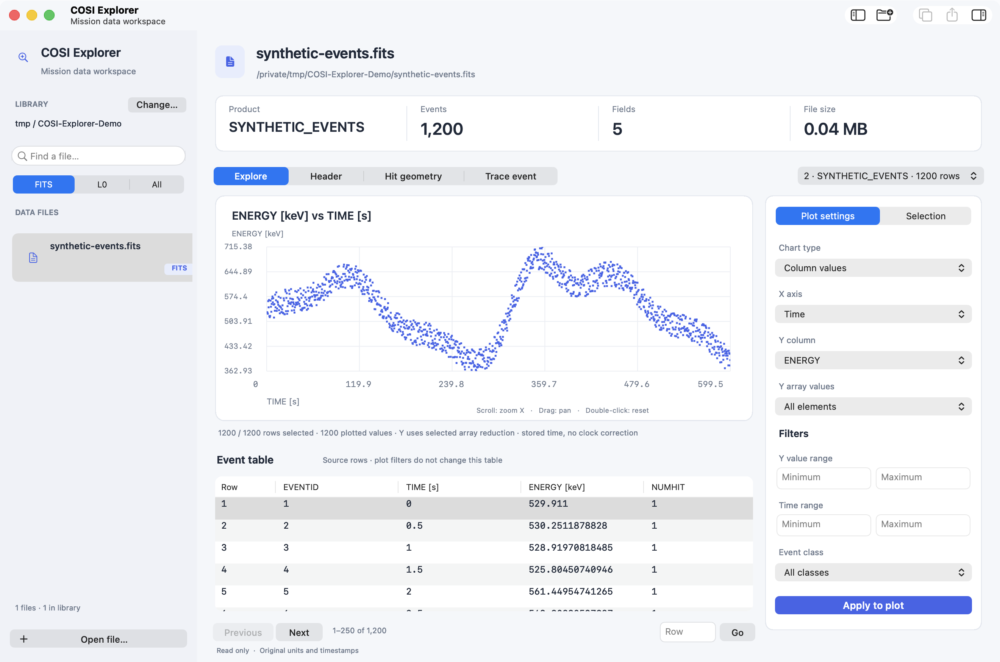

<div align="center">


[](#get-started)
[](https://github.com/mwy-wing/COSI-FITS-EXPLORER/tree/v0.1.0)
[](LICENSE)

[Get started](#get-started) · [User guide](docs/USER_GUIDE.md) · [Contribute](CONTRIBUTING.md)

</div>

A native macOS app for browsing FITS files, visualizing columns, and exploring COSI events.



<p align="center"><sub>Native macOS interface · Synthetic demo data</sub></p>

## What you can do

- **Inspect** FITS tables, headers, images, and supported COSI packet files.
- **Plot** column values against time or row number, with filters and histograms.
- **Compare** spectra and export your plots to CSV.
- **Explore** hit geometry and trace events across processing stages.

Your files stay on your computer and are opened read-only.

## Get started

**Apple Silicon · macOS 15+**

Install [Xcode Command Line Tools](https://developer.apple.com/xcode/resources/) first, then:

```sh
git clone https://github.com/mwy-wing/COSI-FITS-EXPLORER.git
cd COSI-FITS-EXPLORER
brew install cmake pkg-config cfitsio
bash build.sh
open "dist/COSI Explorer.app"
```

Open a FITS or packet file, choose **X axis → Time / Row number**, and pick a **Y column**.

DMG downloads are not published yet. Watch [Releases](https://github.com/mwy-wing/COSI-FITS-EXPLORER/releases) for updates. The current build is not Apple-notarized.

---

[User guide](docs/USER_GUIDE.md) · [Release guide](docs/RELEASING.md) · [Contributors](AUTHORS.md) · [MIT license](LICENSE)
