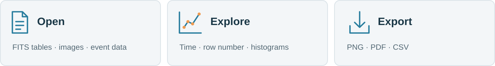
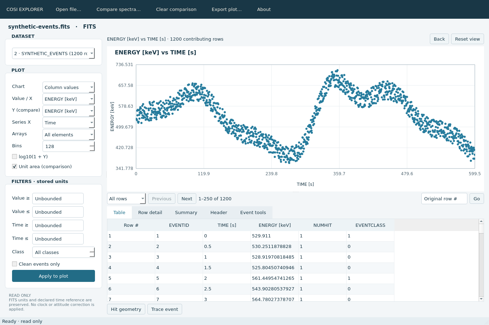

<div align="center">


[](#download)
[](#download)
[](CMakeLists.txt)
[](https://github.com/mwy-wing/COSI-FITS-EXPLORER/actions/workflows/build.yml)
[](https://github.com/mwy-wing/COSI-FITS-EXPLORER/releases/tag/v0.2.0)
[](LICENSE)
[](docs/USER_GUIDE.md#data-scope-and-reopening)

**[Download ↓](#download)** · [Try demo data](https://github.com/mwy-wing/COSI-FITS-EXPLORER/releases/download/v0.2.0/synthetic-events.fits) · [User guide](docs/USER_GUIDE.md) · [Report a bug](https://github.com/mwy-wing/COSI-FITS-EXPLORER/issues)

</div>

A desktop app for browsing FITS files, visualizing columns, and exploring COSI events. Built in C++ with a native Mac interface and a Qt interface for Linux.


<p align="center"><sub>Time → Row number → Histogram · Mac app · Synthetic demo data</sub></p>

## What you can do



- **Inspect** FITS tables, headers, images, and supported COSI packet files.
- **Plot** column values against stored time or original row number, with histograms and filters.
- **Investigate** points and contributing rows, with zoom controls and column summaries.
- **Compare** spectra using shared bins; export PNG, PDF, or CSV.
- **Explore** stored hit coordinates and trace events across processing stages.

Your files stay on your computer and are opened **read-only**. Units and declared time references are preserved; this viewer applies no calibration or clock correction.

## On Linux, too



The Linux app includes plots, paged tables, headers, images, summaries, comparison, and event tools. Hit coordinates appear as text; the Mac app also has geometry projections and more workspace controls. [Platform details →](docs/USER_GUIDE.md#platforms)

## Download

| Platform | Installer | Requirements |
| --- | --- | --- |
| 🍎 macOS | [Download DMG](https://github.com/mwy-wing/COSI-FITS-EXPLORER/releases/download/v0.2.0/COSI-Explorer-v0.2.0-macos-arm64.dmg) | Apple Silicon · macOS 15+ |
| 🐧 Ubuntu 22.04 | [Download .deb](https://github.com/mwy-wing/COSI-FITS-EXPLORER/releases/download/v0.2.0/COSI-Explorer-v0.2.0-linux-ubuntu-22.04-amd64.deb) | x86_64 / amd64 |
| 🐧 Ubuntu 24.04 | [Download .deb](https://github.com/mwy-wing/COSI-FITS-EXPLORER/releases/download/v0.2.0/COSI-Explorer-v0.2.0-linux-ubuntu-24.04-amd64.deb) | x86_64 / amd64 |

**Mac:** open the DMG and drag **COSI Explorer** to **Applications**. The download is **not Apple-notarized**; if macOS blocks it, see [Apple's guidance](https://support.apple.com/en-us/102445).

**Ubuntu:** download the package matching your Ubuntu version, then install it from your Downloads folder. For 24.04:

```sh
sudo apt install ./COSI-Explorer-v0.2.0-linux-ubuntu-24.04-amd64.deb
cosi-explorer
```

You can also launch **COSI Explorer** from the application menu. Other distributions and Linux ARM builds are not packaged yet. [All release files and checksums →](https://github.com/mwy-wing/COSI-FITS-EXPLORER/releases/tag/v0.2.0)

## Your first plot

1. Open your file or the [synthetic demo](https://github.com/mwy-wing/COSI-FITS-EXPLORER/releases/download/v0.2.0/synthetic-events.fits).
2. Choose a table HDU, **Column values**, and a numeric value column such as **ENERGY**.
3. Switch X between **Time** and **Row number**. Click a point to inspect its original row.

### Choose your view

| View | X axis | Y axis |
| --- | --- | --- |
| **Column values** | Stored time or original row number | Selected column value |
| **Histogram** | Selected column value | Values per bin |
| **Event counts vs time** | Stored time | Events per time bin |
| **Column comparison** | Selected X column after reduction | First stored element of Y |

Use **Plotted rows** to browse the source rows contributing to the current plot. **Summary** shows their collected values' minimum, maximum, median, and mean, with units and applied filters.

<details>
<summary><b>Build from source</b></summary>

```sh
git clone https://github.com/mwy-wing/COSI-FITS-EXPLORER.git
cd COSI-FITS-EXPLORER
```

**macOS:** install Xcode Command Line Tools, then:

```sh
brew install cmake pkg-config cfitsio
```

**Ubuntu:**

```sh
sudo apt install build-essential cmake pkg-config libcfitsio-dev qt6-base-dev libgl1-mesa-dev dpkg-dev file
```

Then build and run the checks:

```sh
bash build.sh
```

On Mac, open `dist/COSI Explorer.app`. On Linux, run `./build/cosi-explorer` or install the `.deb` created in `dist/`. The [guide](docs/USER_GUIDE.md#build-tests-and-releases) covers tests and packaging.

</details>

---

[User guide](docs/USER_GUIDE.md) · [Releases](https://github.com/mwy-wing/COSI-FITS-EXPLORER/releases) · [MIT license](LICENSE)
